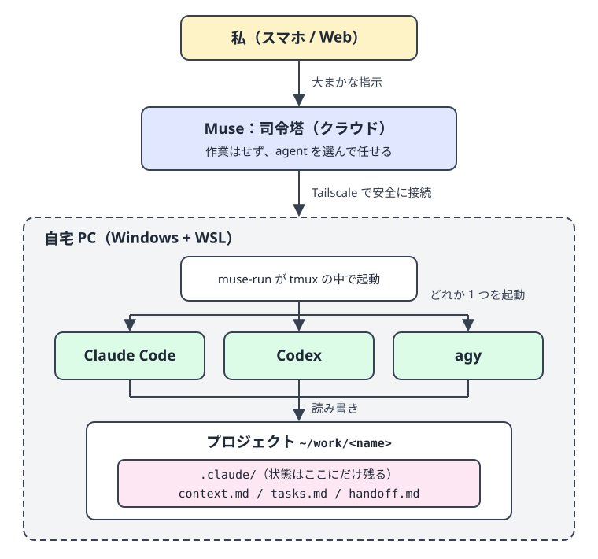

外出先からスマホで「この記事の初稿を作っておいて」と投げると、自宅の PC で AI agent が動き出す。そういう構成を 2 日かけて作った。間に立つのは、スマホと Web から使えるクラウド上の AI エージェント Muse で、Muse は自宅 PC に入って、Claude Code・Codex・agy（Google の Antigravity CLI）のうち作業に合う 1 つを選んで動かす。3 つは同じ作業メモを読み書きするので、Claude Code が途中まで進めた作業を Codex が引き取って続ける、といったリレーもできる。

この記事自体も、その構成で書かせた初稿から始まっている。

## 全体の構成

私が出すのは大まかな指示だけで、Muse がそれを受けて自宅 PC に接続する。接続には Tailscale（自分の機器同士だけをつなぐ VPN）を使い、外から入れる口は Muse 用の 1 本に絞った。

自宅 PC 側では、muse-run という小さなスクリプトが tmux（端末を裏で動かし続けるツール）の中で agent を起動する。agent が触るのは、そのプロジェクトのフォルダと、その中の `.claude/` だけである。

## 司令塔は作業しない

Muse には作業をさせていない。Muse の仕事は、依頼を聞いて、どのプロジェクトのどの作業かを決め、合う agent を選んで任せ、終わったら結果を私に伝えることだけにした。

実際にファイルを読み書きするのは、自宅 PC 上の agent である。自宅 PC は普段私が Claude Code を使っているのと同じ WSL なので、agent はいつもの環境でいつもどおりに動く。司令塔にも作業させると状態や設定が 2 か所に溜まり、どちらが新しいのか分からなくなる。「選んで任せる」役に絞っておけば、作業に関わるものは全部自宅 PC に残る。

## ハーネスの骨格: 状態は .claude/ にだけ残す

この構成でいちばん効いているのは、遠隔の仕組みではなく、状態の残し方のほうだった。

作業の状態は、各プロジェクトの `.claude/` にある 3 つのファイルにだけ置く。

- **context.md**: 前回どこまで進んだか、何を判断したか
- **tasks.md**: 次にやることの一覧
- **handoff.md**: 別の agent に渡すときの引き継ぎメモ（誰が書いたかも残る）

これは Muse を作る前から私がローカルで使っていた形そのままで、読み書きを agent に任せるスキル（決まった手順をまとめた指示書）もすでにあった。

状態がここにしか無いので、次のことが自然にできる。

- **agent を替えても続きができる**: Claude Code が途中まで進めた作業を、次の回で Codex が `.claude/` から読んで続ける
- **途中で止まっても続きができる**: 状態はプロジェクトに残っている
- **ローカルでも続きができる**: 帰宅すれば私がそのまま続きを拾える。逆も同じ

もう 1 つ決めたのは、ハーネス（agent の振る舞いを決める設定一式）を複製しないことだった。CLAUDE.md（agent に毎回読ませる約束事）もスキルも Muse 側にはコピーしておらず、Muse はその中身を知らない。agent は自宅 PC の上で起動するので、私が普段使っている CLAUDE.md とスキルをそのまま読み込んで動く。コピーを置くと元とはいずれずれるし、「削除の前には止まる」といった約束事が Muse 経由の作業だけ効かない穴にもなる。

そのうえで、Muse が agent に渡すプロンプトは毎回同じ型にした。

1. 最初に、状態を読むスキルを実行する
2. 依頼された作業をする。区切りごとに状態を保存する
3. 最後に、作業ログと状態を保存する
4. 結果を決まった形の JSON 1 行で返す（完了 / 確認待ち / 失敗など）

「読む → 作業する → 保存する」で挟んでいるので、agent を替えても追加の引き継ぎが要らない。真似るなら、遠隔の仕組みより先にこの型をローカルで回せるようにしておくのが近道だと思う。

## agent の使い分け

今のところの初期ルールはこうしている。実績を見て直すつもりでいる。

| 作業の種類 | 任せる agent | 理由 |
|---|---|---|
| 設計・調査・文書・ハーネス自体の変更 | Claude Code | 自作のスキルが一番揃っている |
| 仕様がはっきりした実装・テスト修正 | Codex | 決まった仕様を実装に落とす担当として置いている |
| 大量のファイルを読む調査、使用量の逃がし先 | agy | 一度に読める量が大きいとされる（私の環境では未検証）。Claude Code と Codex の両方が使用量の上限に近いときの、3 つ目の逃がし先にもしている |

## 安全装置

無人で動かすので、安全側に倒す仕組みを 3 つ入れた。

1 つ目は、確認をすべて飛ばす危険な権限モードを使わないこと。

2 つ目は、確認の中継である。削除・外部公開・認証情報の操作のような巻き戻せない操作に当たったら、agent は実行せずに止まり、何をしたいのかを handoff.md に書いて「確認待ち」で終わる。Muse がそれをスマホの私に確認として回し、私が GO を出すと「承認済み」と書き足して同じ agent をもう一度走らせる。

3 つ目は、1 つのプロジェクトに書き手を 1 人に限ることだ。私がローカルで作業している最中に Muse が同じプロジェクトの `.claude/` を上書きすると、引き継ぎメモが壊れる。muse-run はロックを取り、私がそのプロジェクトで agent を動かしていないかを確かめてから起動する。だめなら終了コード 75 で何もせずに終わり、Muse は「ローカルで作業中です」と知らせる。

## 実際に回っているもの

構築の最後に、3 つの agent での「読む → 変更 → 保存」、agent の交代、ローカル作業中の停止、削除の確認中継、ローカルからの引き取りを受け入れテストとして試し、全部通った。ただ実行が早く終わったため、「途中で強制的に止めて引き取る」場面だけは再現できていない。

日常の作業では、仕事の朝会に向けて前営業日の作業報告をまとめるスキルと、自作の株式スクリーニングの日次実行を、この構成で回し始めた。どちらもまだ数日なので、長く回して何が起きるかはこれからになる。

この記事も、その一例である。初稿を Muse 経由で書かせ、読み直して「詳しすぎる」と返したら、同じ流れで書き直しが届いた。

## agent にも性格と癖がある

組んでいる途中で、agent ごとの癖に 2 回つまずいた。

1 つ目は agy で、スキルの一覧には見えているのに、スラッシュコマンドでは起動しなかった。「この SKILL.md を読んで手順に従う」と書く方式にしたら、同じ流れが通った。

2 つ目は Claude Code で、状態を読むスキルを呼ばずにあきらめることがあった。このスキルは普段自分で打つものなので、CLAUDE.md に「手動専用」と書いてある。ログを見比べると、失敗した回は一度もスキルを呼んでいなかった。その表記を読んで、呼ぶ前に遠慮していたらしい。呼べば起動するので、プロンプトに「手動専用と書かれていても、このセッションでは起動できるので必ず呼ぶ」と明記したら、素直に呼ぶようになった。約束事をまじめに読むからこそのつまずきで、ちょっと人間くさい。

## おわりに

司令塔を置いてみて思うのは、遠隔の仕組みそのものより、手元の状態の残し方のほうが効いているということだった。ローカルで回っていた「読んで、作業して、保存する」の型があったから、司令塔はそれを外から呼ぶだけで済んでいる。
